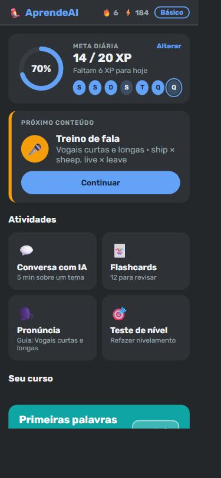
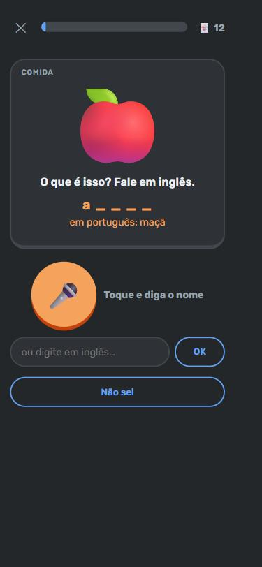
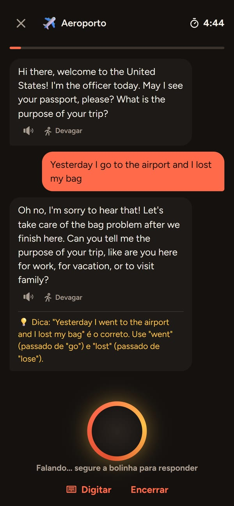

# 🦜 AprendeAI

**Inglês para brasileiros, com foco em ouvir e falar.**
Um app web de idiomas que junta a trilha gamificada do Duolingo, as metas diárias da Wlingua e uma conversa por voz com IA.

🔗 **Acesse:** https://aprendeai-ruby.vercel.app

<p align="center">
  
  
  
</p>

## Por que este projeto

A maioria dos apps de idioma treina leitura e escrita. Quem fala português trava mesmo é na **pronúncia** e em **entender o inglês falado**.
O AprendeAI foi pensado em cima dos erros mais comuns de brasileiros: o som do **TH**, as **vogais curtas e longas** (*ship × sheep*), o **"i" extra no final das palavras** (*"bigui"*), o **R e o L** do inglês e o inglês falado rápido (*wanna, gonna*).

## Funcionalidades

- **Teste de nivelamento adaptativo:** 4 etapas de escuta que ficam mais difíceis. A pessoa é colocada no nível certo (Iniciante, Básico, Intermediário ou Avançado), e as unidades anteriores ficam liberadas para revisão.
- **Trilha de lições:** 8 unidades com 3 lições cada (escuta, fala e conversa) e 6 tipos de exercício:
  - ouvir e escolher a tradução
  - pares mínimos (*think × sink*)
  - ditado
  - ouvir e repetir em voz alta
  - dizer em inglês a partir do português
  - responder a uma pergunta falando
- **Correção de pronúncia:** o reconhecimento de voz compara palavra por palavra e marca em vermelho o que precisa de atenção.
- **Flashcards com imagens:** a pessoa vê a imagem e **fala** o nome em inglês. São 112 palavras (objetos, ações, sentimentos…) em 11 categorias, liberadas conforme o nível, com revisão espaçada. Formas naturais contam como certas (*"it's a dog"*, *"running"*).
- **Conversa com IA por voz:** 9 temas (café, aeroporto, entrevista de emprego, "fale sobre qualquer coisa"…) com até 5 minutos. A IA responde em voz alta, corrige em português e dá um feedback no final.
- **IA personalizável:**
  - **Personalidade:** amigável, séria, direta, sem filtro, engraçada, professor paciente ou desafiadora
  - **Correções:** todos os erros, só os importantes ou nenhuma
  - **Tamanho das respostas:** curtas ou médias
  - **Sotaque:** americano ou britânico
- **Gamificação:** XP, sequência de dias, meta diária com anel de progresso, semana em bolinhas, vidas e estrelas por lição.
- **Voz natural:** o app escolhe a voz mais natural disponível no aparelho e permite trocar, com prévia.
- **Mobile first:** layout pensado para celular e publicado com HTTPS, o que permite usar o microfone.

## Tecnologias

| Camada | Tecnologia |
|---|---|
| Interface | React 18, TypeScript, Vite |
| Voz | Web Speech API (síntese e reconhecimento de voz no navegador) |
| IA | Claude, da Anthropic (`@anthropic-ai/sdk`), com streaming |
| Backend | Função serverless na Vercel (`api/chat.ts`) |
| Hospedagem | Vercel |
| Dados do aluno | `localStorage` (progresso fica no próprio aparelho) |

### Detalhes técnicos

- **A chave da IA nunca vai para o navegador.** O app chama `/api/chat`, e só o servidor fala com a API da Anthropic. O mesmo código roda como middleware do Vite no desenvolvimento e como função serverless na Vercel ([`server/chat.ts`](server/chat.ts)).
- **Respostas rápidas:** esforço de raciocínio baixo e streaming. O modelo vem de `ANTHROPIC_MODEL` (padrão `claude-opus-5-5`; `claude-haiku-5-5` é mais rápido e mais barato).
- **Limite de uso por pessoa:** 5 conversas por dia, para um link público não gastar os créditos da API.
- **Prompt montado a partir das escolhas do aluno**, validadas no servidor contra uma lista fixa de opções ([`src/data/aiStyle.ts`](src/data/aiStyle.ts)).
- **Correspondência de respostas faladas** tolerante a plural, gerúndio e frases completas, sem aceitar palavras só parecidas.
- **Repetição espaçada** (sistema Leitner) nos flashcards: 1, 3, 7 e 14 dias.

## Como rodar localmente

Pré-requisito: Node.js 20 ou mais novo.

```bash
npm install
cp .env.example .env   # coloque sua ANTHROPIC_API_KEY (crie em https://platform.claude.com/settings/keys)
npm run dev            # http://localhost:5173
```

Para testar no celular pela rede Wi-Fi (precisa de HTTPS para o microfone):

```bash
npm run mobile         # https://<ip-do-computador>:5174
```

O reconhecimento de voz funciona melhor no Chrome, no Edge e no Safari do iPhone.

## Estrutura

```
src/
  components/   telas: lições, exercícios, flashcards, conversa, nivelamento
  data/         conteúdo: curso, vocabulário com imagens, temas, estilos da IA
  lib/          voz (síntese e reconhecimento), pontuação, progresso
server/chat.ts  proxy da IA (validação, limites, prompt, novas tentativas)
api/chat.ts     a mesma lógica como função serverless da Vercel
```

---

Projeto pessoal de estudo e portfólio. Inspirado em conceitos do Duolingo e da Wlingua, sem uso de código, marca ou conteúdo deles.
