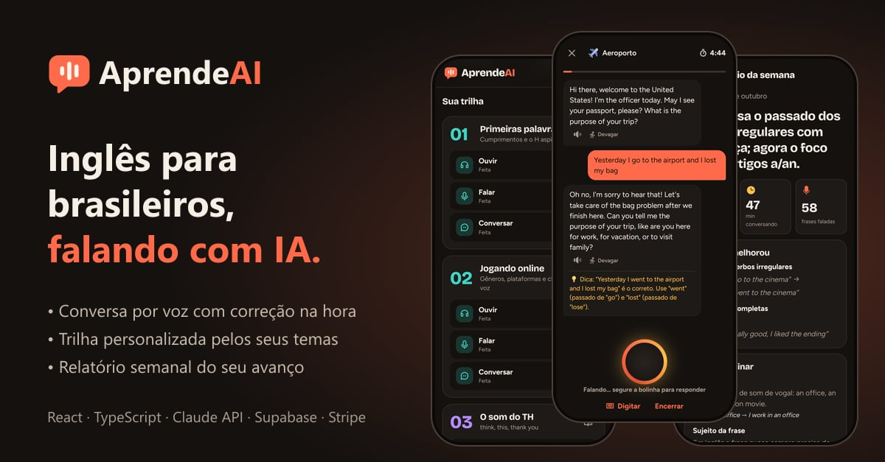
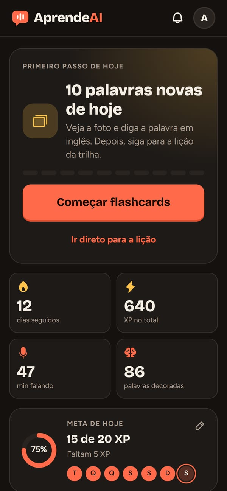
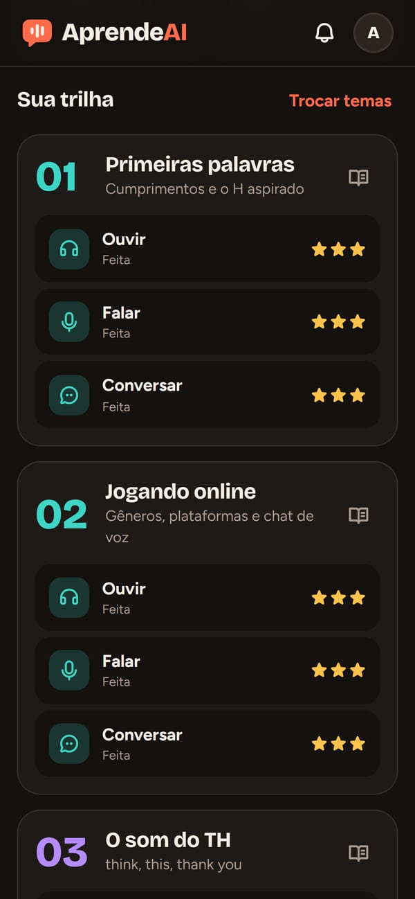
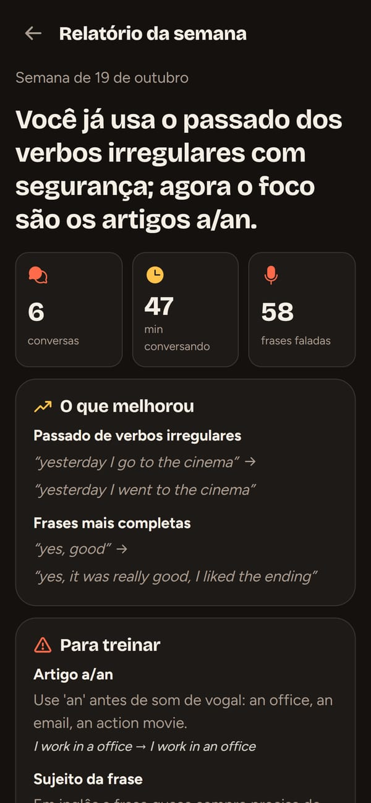

# AprendeAI

**Inglês para brasileiros, com foco em ouvir e falar, e uma IA que conversa por voz e acompanha a sua evolução.**

🔗 **Acesse:** https://aprendeai-ruby.vercel.app

<p align="center">
  
</p>

<p align="center">
  
  
  
  
</p>

## Por que este projeto

A maioria dos apps de idioma treina leitura e escrita. Quem fala português trava mesmo é na **pronúncia** e em **entender o inglês falado**.
O AprendeAI foi pensado em cima dos erros mais comuns de brasileiros: o som do **TH**, as **vogais curtas e longas** (*ship × sheep*), o **"i" extra no final das palavras** (*"bigui"*), o **R e o L** do inglês e o inglês falado rápido (*wanna, gonna*). E coloca a pessoa para **falar desde o primeiro dia**, conversando com uma IA que corrige na hora e lembra das dificuldades dela.

## Funcionalidades

### Conversa por voz com IA
- **Segure para falar:** a pessoa segura a bolinha, fala e solta para enviar. A IA (Claude, da Anthropic) responde em voz alta e corrige em português, com uma dica abaixo da resposta.
- **9 temas**, de café e aeroporto a entrevista de emprego e "fale sobre qualquer coisa", com um feedback no final.
- **IA personalizável:** personalidade (amigável, séria, professor paciente, desafiadora…), quantidade de correções, tamanho das respostas e sotaque americano ou britânico.

### Uma IA que acompanha a evolução
- **Agente de dificuldades:** as conversas ficam salvas. Ao fim de cada uma, um agente relê as últimas conversas e atualiza o perfil do aluno: pontos fracos com exemplos reais e o foco da próxima conversa. A IA usa esse perfil para puxar a prática do que a pessoa mais erra.
- **Relatório semanal (Premium):** todo domingo, um agente compara as conversas da semana com o perfil anterior e escreve o que melhorou (com o antes e o depois), o que treinar e uma meta. O relatório chega por notificação e fica no **sino** da tela inicial.

### Curso
- **Teste de nivelamento adaptativo:** 4 etapas de escuta que ficam mais difíceis e colocam a pessoa no nível certo.
- **Trilha personalizada:** a pessoa escolhe **5 de 15 temas** (games, tecnologia, trabalho, viagem, música…). A trilha alterna as unidades de pronúncia com as unidades desses temas, num total de 16 unidades com 3 lições cada (escuta, fala e conversa). As 28 unidades de temas foram escritas com IA uma vez e revisadas ([`scripts/theme-units.mjs`](scripts/theme-units.mjs)).
- **6 tipos de exercício:** ouvir e escolher, pares mínimos (*think × sink*), ditado (na segunda tentativa só se corrige o que errou), repetir em voz alta, dizer em inglês a partir do português e responder falando.
- **Correção de pronúncia:** o reconhecimento de voz compara palavra por palavra e marca em vermelho o que precisa de atenção.
- **Flashcards com fotos reais:** 10 palavras novas por dia, ditas em voz alta, com repetição espaçada e contador de palavras decoradas.
- **Voz natural gravada:** as 812 frases e palavras fixas do curso foram gravadas uma vez com o Kokoro, modelo de voz open-source (Apache-2.0), em sotaque americano e britânico ([`scripts/course-audio.ts`](scripts/course-audio.ts)). Custo zero por uso e a mesma voz em qualquer celular.
- **Botão "Devagar"** em todo áudio: frases curtas palavra por palavra, com pausa entre elas.
- **Gamificação:** XP, sequência de dias, meta diária, estrelas por lição e sons de acerto e erro.

### Modo Kids
Escolhido na primeira tela ou pelo menu da conta, com visual claro e o papagaio **Kiko** como mascote. O adulto escolhe a **faixa etária**, que ajusta as atividades e o jeito do Kiko falar:

| | 0 a 3 | 3 a 6 | 6 a 10 | Mais de 10 |
|---|---|---|---|---|
| Cartões | Livro de figuras (ver e ouvir) | Ver e falar | Ver e falar | Mais palavras |
| Ouça e toque | 2 figuras | 3 figuras | 4 figuras | 4 figuras |
| Rimas | Só ouvir e cantar junto | Repetir (tolerante) | Repetir | Repetir (mais exigente) |
| Kiko | Desligado | Frases bem curtas, 2 min | Frases curtas, 3 min | Perguntas abertas, 5 min |

A conversa com o Kiko tem regras de segurança fixas no prompt: inglês simples, só temas infantis, nunca pede dados pessoais e, se a criança disser algo preocupante, orienta a falar com um adulto. A **Área dos pais**, protegida por uma conta de multiplicar, mostra os dias praticados, as palavras e o tempo falando inglês.

### Produto
- **Conta com e-mail e senha ou Google:** o progresso fica salvo na conta e aparece em qualquer aparelho.
- **Premium com Stripe:** R$ 9,99/mês ou R$ 89,90/ano, com 7 dias grátis na primeira assinatura. O plano grátis inclui a primeira unidade, 1 conversa com IA por dia e parte do Modo Kids. O Premium libera a trilha inteira, 30 minutos de conversa por dia, o relatório semanal e o Kids completo. Os limites são aplicados no servidor.
- **Notificações:** lembrete diário às 19h para quem ainda não estudou ("Sua ofensiva de 5 dias está em risco!"), aviso 2 dias antes do fim do teste grátis e o relatório semanal.
- **App instalável (PWA)**, pensado primeiro para o celular.
- **LGPD:** política de privacidade e termos de uso, exclusão da conta e de todos os dados pelo próprio app, e fontes servidas pelo próprio site.

## Tecnologias

| Camada | Tecnologia |
|---|---|
| Interface | React 18, TypeScript, Vite, Phosphor Icons |
| Voz | Kokoro TTS (áudios do curso gerados uma vez) e Web Speech API (reconhecimento e voz das respostas da IA) |
| IA | Claude, da Anthropic (`@anthropic-ai/sdk`), com streaming |
| Backend | Funções serverless na Vercel |
| Tarefas em segundo plano | Trigger.dev: agente de dificuldades, relatório semanal, lembretes agendados e avisos com atraso |
| Banco de dados e contas | Supabase: PostgreSQL com RLS, Auth (e-mail e senha, Google) |
| Pagamentos | Stripe: Checkout, portal do cliente e webhooks |
| Notificações | Web Push (service worker e `web-push`) |
| Hospedagem | Vercel |

### Detalhes técnicos

- **Nenhuma chave vai para o navegador.** O app chama `/api/*`, e só o servidor fala com a Anthropic, o Stripe e o Supabase. O mesmo código roda como middleware do Vite no desenvolvimento e como função serverless na Vercel ([`server/`](server/)).
- **IA rápida e barata:** `claude-haiku-5-5` por padrão, com esforço de raciocínio baixo e streaming. O agente de dificuldades roda no Trigger.dev depois que a conversa termina, então o aluno não espera por ele, com novas tentativas automáticas e uma execução por aluno por vez.
- **Limites por conta no servidor:** conversas grátis por dia e minutos ativos de conversa no Premium, contados no Supabase (RPC `use_quota`).
- **Assinatura espelhada do Stripe** no Supabase por webhook verificado, e o aviso de fim do teste é agendado no Trigger.dev quando a assinatura começa.
- **Microfone confiável no iPhone:** o Safari só abre o reconhecimento de voz dentro do toque e às vezes nunca avisa que terminou. Por isso o microfone abre no próprio toque, sempre termina por conta própria (com tempos-limite) e aproveita o texto parcial que o Safari mostra.
- **Correspondência de respostas faladas** tolerante a plural, gerúndio, contrações e frases completas, sem aceitar palavras só parecidas.
- **Repetição espaçada** (sistema Leitner) nos flashcards.
- **Banco versionado:** todas as tabelas e políticas de segurança estão em [`supabase/migrations/`](supabase/migrations/).

## Como rodar localmente

Pré-requisito: Node.js 20 ou mais novo.

```bash
npm install
cp .env.example .env   # preencha as chaves (o arquivo explica cada uma)
npm run dev            # http://localhost:5173
```

Só a `ANTHROPIC_API_KEY` é obrigatória para a conversa com IA. Sem as outras, o app usa a voz do aparelho, guarda os limites em memória e deixa as notificações e o Premium desligados.

Para testar no celular pela rede Wi-Fi (o microfone exige HTTPS):

```bash
npm run mobile         # https://<ip-do-computador>:5174
```

Tarefas do Trigger.dev:

```bash
npm run dev:trigger      # roda as tarefas localmente
npm run deploy:trigger   # publica as tarefas
```

O reconhecimento de voz funciona melhor no Chrome, no Edge e no Safari do iPhone.

## Estrutura

```
src/
  components/   telas: início, lições, exercícios, flashcards, conversa, temas, relatório, Modo Kids
  data/         conteúdo: curso, unidades dos temas, vocabulário, estilos da IA, conteúdo infantil, planos
  lib/          voz (síntese, áudios gravados e reconhecimento), sons, conta e sincronização, progresso, notificações
server/         lógica do servidor: chat e limites, histórico e agente de dificuldades, relatórios,
                pagamentos, notificações, conta
api/            as rotas serverless da Vercel, que chamam server/
trigger/        tarefas do Trigger.dev (agentes, agendamentos e avisos)
supabase/       migrações do banco (tabelas, RLS e funções)
scripts/        ferramentas: configuração do Stripe, fotos dos flashcards, unidades dos temas, áudios do curso
public/audio/   áudios gravados do curso (manifest.json lista o que existe por voz)
```

---

Projeto pessoal de estudo e portfólio. Inspirado em conceitos do Duolingo e da Wlingua, sem uso de código, marca ou conteúdo deles.
